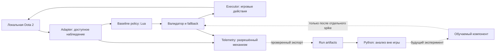

# ARCHITECTURE

**Статус:** предложенная структура, новые модули не реализованы; текущий код — три исходных Lua-callback файла SF v0.1. Основание — Proposed [ADR-0001](docs/adr/0001-baseline-first.md) и [ADR-0002](docs/adr/0002-contracts-and-data.md). Аудит T001 может изменить размещение компонентов без переписывания пригодного кода.

## Фактическое устройство MIDBOT v0.1

Текущий путь: Dota callback → hero_selection / AbilityUsageThink / ItemPurchaseThink → прямой вызов API. Свой mode-файл отсутствует; штатный Valve AI предполагается основой движения/лайнинга/retreat. Реальную совместимость нужно подтвердить T003/T005. Модели, Python bridge и телеметрии нет.

SF и mid уже выбраны исходным проектом; mid назначение ещё не реализовано явно. Consider-функции и константы сохраняются, пока есть причины их менять. Ниже схема развития, а не обязательный немедленный refactor. Контракт enum noop/move/attack не описывает уже реализованные ability callbacks; если вводится общий контракт, T004 обязан включить реальные способности и покупки либо ограничить его только данными телеметрии.

## Принцип

Сначала небольшой игровой контур с фиксированными действиями и правилами. Анализ и обучение отделены от исполнения в игре. Подключение обучаемого компонента не меняет интерфейс остальных модулей и сохраняет baseline как fallback.



Сплошные связи — целевая схема раннего этапа, а не доказательство реализации. Пунктирные связи имеют отдельные технические условия. В частности, схема не подразумевает, что Lua умеет писать любые файлы или синхронно вызывать Python.

## Компоненты и границы

| Компонент | Делает | Не делает | Предлагаемый путь |
|---|---|---|---|
| Game adapter | Читает доступные поля, нормализует идентификаторы и время | Не выбирает тактику; не предоставляет скрытую информацию | `bot/adapter/` |
| Policy | Выбирает одно типизированное действие по observation и своему state | Не вызывает игровой API напрямую | `bot/policy/` |
| Validator | Проверяет тип, свежесть, цель, границы; выбирает fallback | Не исполняет присланный код | `bot/runtime/` |
| Executor | Сопоставляет разрешённое действие фиксированному вызову API | Не доверяет внешней строке команды | `bot/runtime/` |
| Telemetry | Фиксирует observation/action/outcome и причины отказа | Не блокирует управление из-за потери аналитики | `bot/telemetry/` |
| Analysis | Читает сохранённые run и строит сводку | Не требует подключённой игры | `analysis/` |
| Experiment | Проверяет одну гипотезу и сохраняет модель/конфиг | Не заменяет production baseline автоматически | `experiments/` |
| Launch tooling | Установка/запуск/восстановление файлов после проверки | Не копирует bota launcher и не предполагает headless | `tools/launch/` |

Пути пока логические, папки с кодом не созданы. Не использовать их как существующие команды. Будущие `contracts/`, `configs/`, `tests/` согласуются в T004. `runs/` и checkpoints хранятся вне обычного Git либо исключаются; небольшие обезличенные fixtures допустимы.

## Контракты v0: проект для согласования T004

В игровом процессе это обычные Lua-таблицы. JSON ниже — предлагаемый формат переносимого fixture/экспорта, не готовый wire protocol. Поля, недоступные в конкретном API, помечаются явно; не заменяются нулём.

### Observation

```json
{
  "schema_version": "0.1",
  "match_id": "sample-001",
  "seq": 17,
  "game_time_s": 42.5,
  "actor_id": "hero-1",
  "self": {"alive": true, "hp": 420, "max_hp": 600, "position": [100, 200, 0]},
  "visible_units": [],
  "missing_fields": ["gold"]
}
```

`seq` монотонен в одном match; игровые секунды отделены от wall-clock. Отрицательное pregame time возможно и должно быть оговорено в сценарии. Пространственные координаты — world units игры, не пиксели. Entity ID действует только в пределах match; adapter не допускает использования старого handle после исчезновения цели. Набор видимых юнитов ограничен выбранной стороной.

### Action

```json
{
  "schema_version": "0.1",
  "match_id": "sample-001",
  "observation_seq": 17,
  "action_id": "sample-001:hero-1:17",
  "actor_id": "hero-1",
  "kind": "move",
  "target_position": [120, 210, 0],
  "reason_code": "lane_position"
}
```

Начальный enum: `noop`, `move`, `attack`. Для move требуется конечный вектор без NaN/Inf; для attack — актуальный доступный `target_id`; поля другого вида действия запрещены. Способности и предметы появляются с новой версией контракта после задачи. `noop` означает не выдавать новый приказ: он **не отменяет уже выполняемое действие**. Для прерывания действия нужен отдельно проверенный executor-путь; не объявлять noop гарантией остановки.

### Исполнение и ошибки

1. Adapter создаёт observation; policy возвращает action.
2. Validator проверяет версию, match/actor, соответствие observation, дедупликацию, состояние героя и валидность цели непосредственно перед исполнением.
3. По одной принятой команде на решение; не накапливать просроченные приказы. При недоступной цели — baseline-пересчёт из свежего observation; при ошибке самого baseline — noop и запись причины.
4. Подтверждение «submitted» означает вызов игрового API, но не доказательство результата. `outcome` определяется отдельно следующими наблюдениями.
5. Нельзя бесконечно повторять action_id, приводить неизвестное действие к attack или подменять invalid-данные нулями.

При будущем асинхронном bridge нужны deadline/TTL, очереди с ограничением, корреляция по match/seq, тесты disconnect/reorder/duplicate и измеренный p95 latency. Числовой TTL и частота решений выбираются по T003/T011, а не выдумываются заранее. Timeout → локальный baseline; потеря телеметрии не останавливает героя.

## Телеметрия и manifest

Логическое событие: `schema_version, run_id, match_id, seq, game_time_s, actor_id, policy_version, proposed_action, executed_action, validation_status, rejection_reason, outcome`. Идентификатор решения связывает события; отсутствие outcome остаётся unknown.

Для каждого run сохраняется manifest: code commit и dirty-state, config hash, schema/policy version, build/patch игры, ОС, герой/сторона/соперник, сценарий, фактическая длительность, UTC start/end, seed если доступен, результат завершения и путь к артефактам. Данные разной версии не смешиваются молча.

Целевой экспорт — JSONL и отдельный manifest JSON после подтверждения механизма T006. До проверки не утверждаем доступность socket, protobuf stream или записи в файловую систему из Lua. Возможен сбор из разрешённых логов с offline-конвертером; сравнить полноту и влияние на производительность. Полный протокол оценки — [EVALUATION](docs/EVALUATION.md).

## Изменения и технические ограничения

Breaking change: новый schema major, миграция fixtures, тесты producer/consumer и согласие обоих. Совместимое добавление: обновить schema minor и parser; неизвестные поля разрешаются только по явно принятому правилу T004. Версия конфигурации независима от версии модели.

GSI-поток, Bot Scripting API и Workshop VScript имеют разные назначения. Наличие данных в одном интерфейсе не доказывает возможность управления через него. Наличие внешнего проекта не доказывает совместимость текущей Windows/игры. Проверенные команды и точные функции API записываются только после T003.

Пока не выбраны: transport, training framework, algorithm, checkpoint format, база данных, inference server. SQLite/PostgreSQL и сервисная инфраструктура добавляются только при конкретной потребности, не «на будущее».
